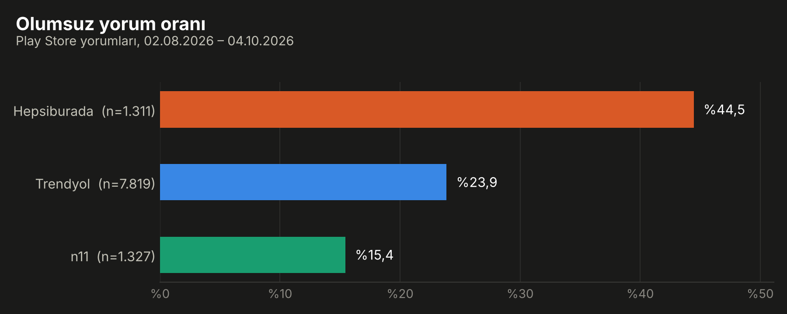
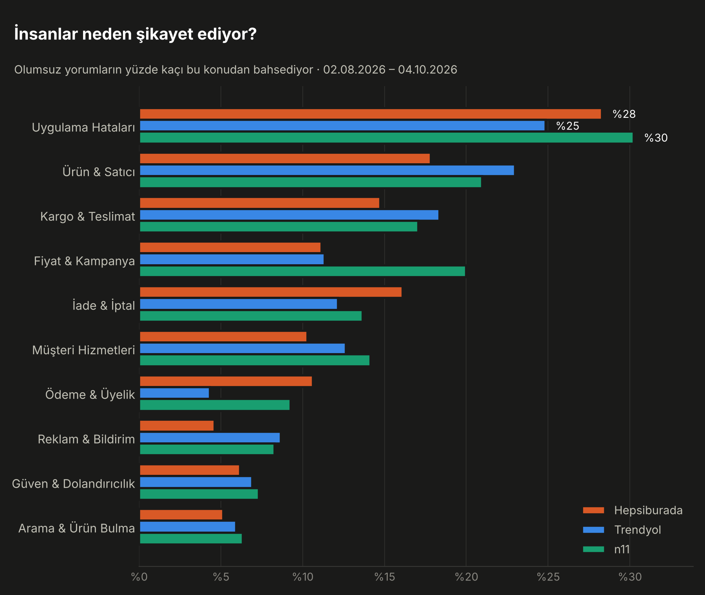
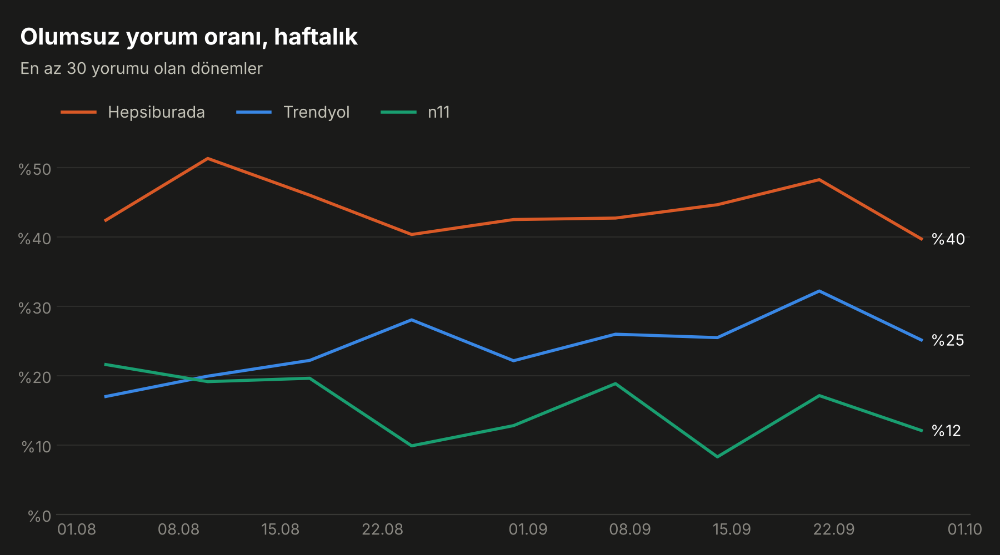

# E-ticaret Uygulamaları: Play Store Yorumlarında Duygu ve Şikayet Analizi

**Rapor:** https://ozgurnurettinozturk.com/e-ticaret-yorum-analizi

Trendyol, Hepsiburada ve n11'in Google Play'deki Türkçe yorumlarını çekip duygu analizi yapar,
hazır modeli bu veriye uyarlar, sonucu yıldız puanına karşı doğrular ve olumsuz yorumların
hangi konularda toplandığını çıkarır.

## Sonuçlar (02.08.2026 – 04.10.2026, 10.457 yorum)

| | Hepsiburada | Trendyol | n11 |
|---|---|---|---|
| Yorum sayısı | 1.311 | 7.819 | 1.327 |
| Ortalama yıldız | 3,48 | 4,19 | 4,49 |
| Olumsuz yorum oranı | %44,5 | %23,9 | %15,4 |
| 4-5 yıldız verip şikayet yazanlar | %12,7 | %7,6 | %4,9 |

- **Hazır model yetmedi.** BERTurk tek başına 4-5 yıldızlı yorumların %17'sini olumsuz saydı
  ("memnunum" dahil). Veriye uyarlayınca yıldızla uyum %85,3'ten %92,3'e, macro-F1 0,81'den 0,89'a çıktı.
- **Yıldız, memnuniyetsizliği eksik gösteriyor.** 4-5 yıldızlı her 13 yorumdan biri şikayet ya da
  istek içeriyor; bir kısmı "yorumum üstte görünsün diye 5 verdim" diye açıkça yazıyor.
- **Üç markada da bir numaralı şikayet uygulama hataları** (olumsuz yorumların %25-30'u):
  açılmama, donma, giriş yapamama.
- **Markaya özgü farklar:** n11'de fiyat şikayeti diğerlerinin yaklaşık iki katı (%20'ye karşı %11).
  Hepsiburada'da iade (%16) ve ödeme/üyelik (%11) öne çıkıyor. Trendyol'da ürün/satıcı (%23) ve kargo (%18).





## Çalıştırma

```bash
pip install -r requirements.txt
python 01_scrape.py      # -> data/reviews.csv
python 02_analyze.py     # ilk çalıştırmada model iner; sonrakilerde kayıtlı skorlar kullanılır
```

Çıktılar `outputs/` klasörüne düşer. Modeli baştan çalıştırmak için `--rescore`.

## Yöntem

1. **Veri:** `google-play-scraper` ile son 90 günün yorumları (uygulama başına en çok 8.000).
   Kullanıcı adı ve profil fotoğrafı alınmaz. Karşılaştırma adil olsun diye tüm markalar
   aynı tarih aralığına kırpılır.
2. **Duygu:** `savasy/bert-base-turkish-sentiment-cased` (BERTurk, pozitif/negatif).
3. **Uyarlama:** BERT skoru ve yorum metni (karakter n-gram TF-IDF) bir lojistik regresyona girer;
   etiket yıldız puanıdır (1-2 olumsuz, 4-5 olumlu, 3 hariç). Skorlar 5 katlı çapraz doğrulamadan
   gelir: hiçbir yorum kendi yıldızını görmüş bir modelden skor almaz.
4. **Doğrulama:** Hazır ve uyarlanmış modelin yıldızla uyumu (doğruluk, macro-F1, karışıklık matrisi).
5. **Konular:** On konuluk kelime-kökü sözlüğü. Türkçe karaktersiz yazılan yorumlar da yakalanır.

## Sınırlar

- Yıldız puanı kusursuz bir etiket değildir; yüksek yıldızlı şikayetler bunun kanıtı.
  Doğruluk rakamı "yıldızla uyum" olarak okunmalı.
- Model ikili çalışır; "güzel ama kargo yavaş" gibi karışık yorumlar çoğunlukla olumsuz sayılır.
- n11'in olumsuz yorum sayısı az (205); konu payları yaklaşık ±6 puan oynayabilir.
- Konu sözlüğü kural tabanlıdır ve olumsuz yorumların yaklaşık dörtte birine konu atayamaz
  (bunların bir kısmı "berbat" gibi tek kelimelik yorumlar).
- Play Store yorumları uygulamayı kullananların sesidir, tüm müşterileri temsil etmez.

## Başka sektöre uyarlama

`01_scrape.py` içindeki `APPS` sözlüğünü ve gerekirse `02_analyze.py` içindeki `TOPICS` sözlüğünü değiştirmek yeterli.
